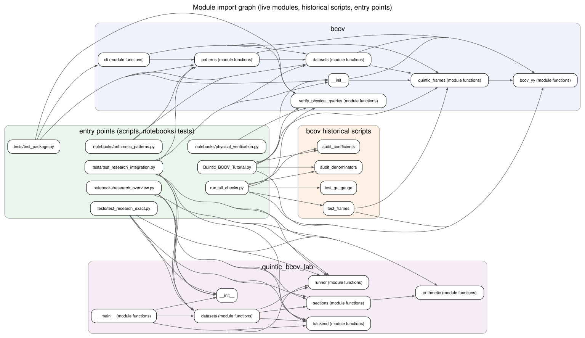
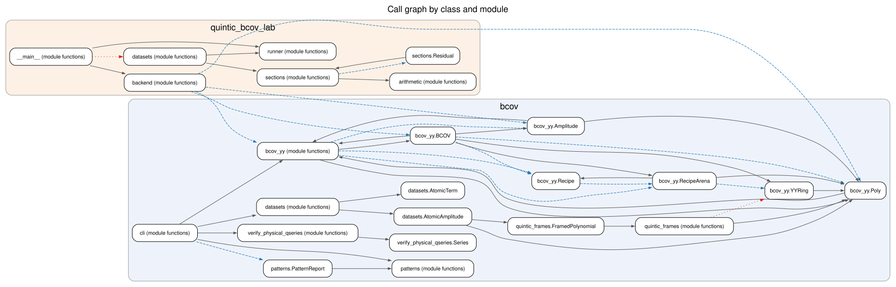
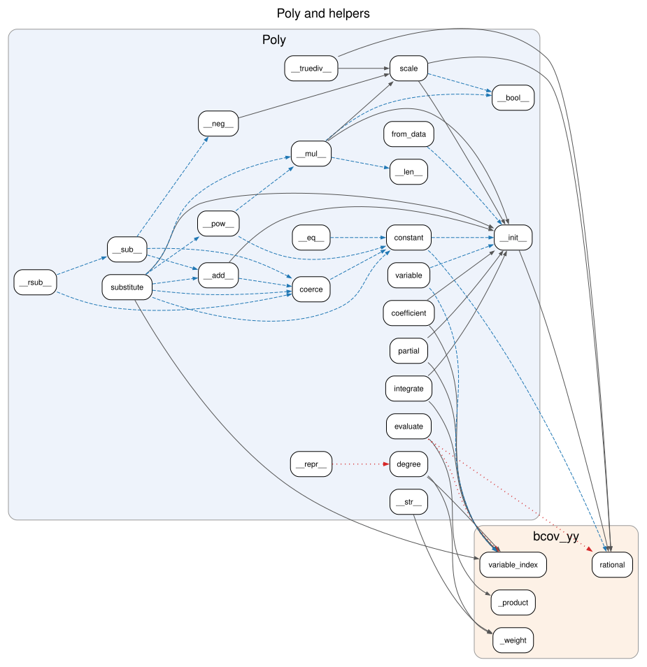
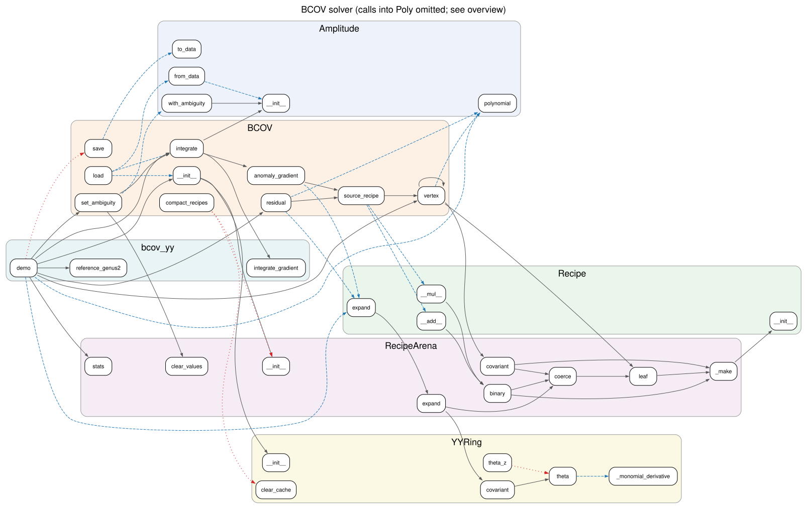
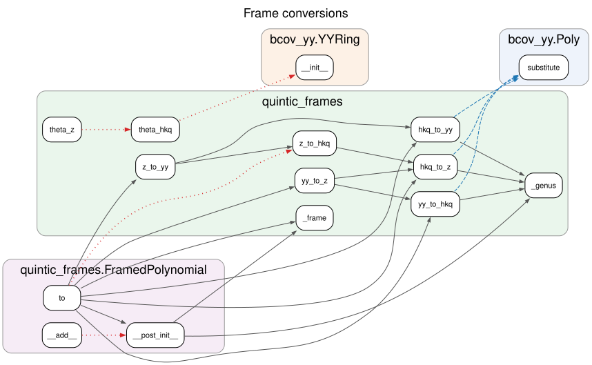
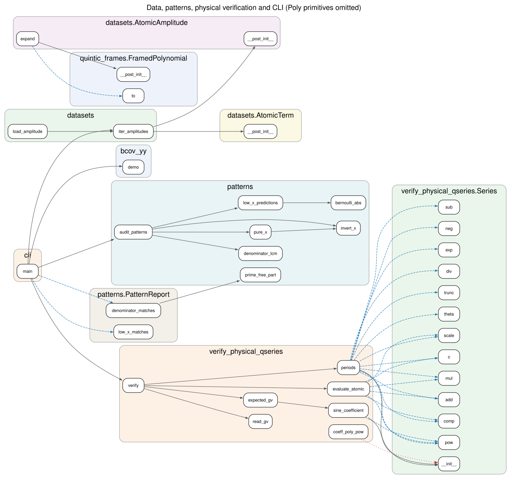
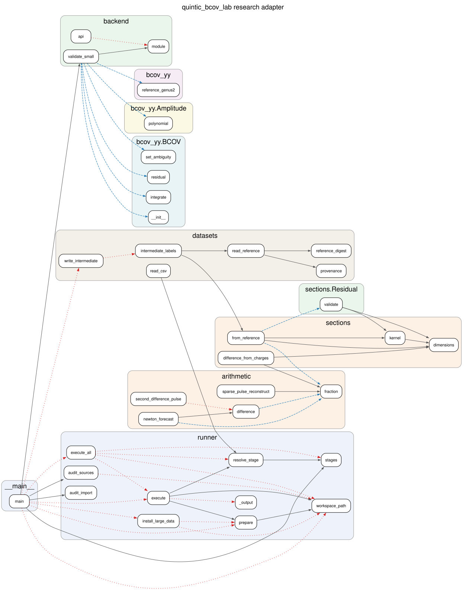

# Architecture

This repository ships one installable distribution, `bcov-symbolic`, with two
Python packages:

- **`bcov`**: the exact-arithmetic toolkit. It provides the quintic BCOV
  recursion, coordinate frames, bundled source data, arithmetic pattern
  audits and GW/GV verification.
- **`quintic_bcov_lab`**: the research adapter for the archived
  *Sequential Research v1.3* studies. It contains exact section and arithmetic
  APIs, provenance-checked data access and a runner for the 18 historical
  stages.

Everything is standard-library Python over `fractions.Fraction`; floats are
rejected wherever a coefficient is exact. The call graphs below are generated
by Graphviz from the live code. To regenerate them after a change, see
[Regenerating](#regenerating).

## Layers

```
 entry points   bcov CLI (bcov.cli)        quintic-bcov CLI (quintic_bcov_lab.__main__)
                marimo notebooks, Quintic_BCOV_Tutorial.py, tests/, run_all_checks.py
                        │                               │
 analysis       bcov.patterns  bcov.verify_physical_qseries   quintic_bcov_lab.{datasets,runner}
                        │                │                     quintic_bcov_lab.{sections,arithmetic}
 data           bcov.datasets ───────────┘                     quintic_bcov_lab.backend ──┐
                        │                                                                  │
 core           bcov.quintic_frames ──► bcov.bcov_yy ◄──────────────────────────────────────┘
```

| Module | Role |
|---|---|
| `bcov.bcov_yy` | Sparse exact polynomial ring `Poly` in Q[u, v1, v2, v3, X]. `YYRing` holds the theta derivation and covariant derivatives. `Recipe`/`RecipeArena` form an interned, lazily expanded arithmetic DAG. `BCOV` is the genus-by-genus anomaly solver, with explicit ambiguity status and JSON checkpoints. |
| `bcov.quintic_frames` | The YY, HKQ and small-z coordinate and normalisation maps, plus `FramedPolynomial`, which refuses to mix frames or genera. |
| `bcov.datasets` | Streams the bundled HKQ atomic amplitudes (genera 2 to 15) as immutable `AtomicAmplitude`/`AtomicTerm` records. |
| `bcov.patterns` | Pure-X jets taken without polynomial expansion, Bernoulli low-X predictions, X inversion, denominator lattices and `PatternReport`. |
| `bcov.verify_physical_qseries` | Truncated exact power series (`Series`), periods and the inverse mirror map. Compares q-series coefficients with GV multicover formulas. |
| `bcov.cli` | `bcov recursion | patterns | verify`. |
| `quintic_bcov_lab.backend` | Loads the BCOV engine (by default `bcov.bcov_yy`), checks its convention string and runs a genus-two regression. |
| `quintic_bcov_lab.sections` | Exact residual-section decomposition of reference ambiguities (`Residual`, `from_reference`, `kernel`), plus GV charge-response forward substitution. |
| `quintic_bcov_lab.arithmetic` | Finite differences, Newton forecasting, valuations, period-four phases and empirical envelope formulas. |
| `quintic_bcov_lab.datasets` | Reads the SHA-256-checked reference amplitudes, derives intermediate labels and reads study CSVs. |
| `quintic_bcov_lab.runner` | Stage catalogue, managed workspaces (`.bcov-research/`), subprocess execution of archived studies, and import/source audits. |
| `quintic_bcov_lab.__main__` | `quintic-bcov` CLI. |

The scripts at the top level of `bcov/` that are not listed above
(`audit_*`, `bcov_sparse_converter`, `bcov_reconcile_frames`,
`quintic_invariant_extract`, `test_frames`, `test_gu_gauge`,
`verify_yy_qseries_legacy`) are historical conversion and verification
scripts. They are kept so that earlier outputs can be reproduced. They appear
in the module graph but not in the call graphs. `quintic_bcov_lab/archive/` is
preserved byte-for-byte and is never analysed: it runs only as subprocesses,
with its own pinned engines.

## Main data flows

1. **Recursion.** `BCOV.integrate(g)` builds the source R_g as a recipe DAG
   (`source_recipe` → `vertex` → `RecipeArena.covariant` →
   `YYRing.covariant`). It expands the DAG, reads off the anomaly gradient and
   calls `integrate_gradient`. The holomorphic ambiguity stays unresolved
   until `set_ambiguity` supplies it; `residual` checks the anomaly equation
   exactly.
2. **Frames.** `FramedPolynomial.to` dispatches through
   `quintic_frames._CONVERSIONS` to `yy_to_hkq`, `hkq_to_z` and their
   inverses. Each conversion substitutes the generators and applies the
   genus-dependent Yukawa rescaling.
3. **Patterns.** `iter_amplitudes` streams the atomic data, and `pure_x` takes
   jets using the valuation n+ℓ. `audit_patterns` compares these jets with
   `low_x_predictions` and checks the denominator lattices of all three frames
   (via `invert_x`).
4. **Physical verification.** `verify` builds `periods` once, then for each
   genus runs `evaluate_atomic` (in the q coordinate) and `expected_gv`
   (multicover sums of `sine_coefficient`), and reports exact residuals.
5. **Research lab.** `backend.module()` supplies `bcov.bcov_yy`.
   `datasets.read_reference` verifies checksums, and
   `sections.from_reference` decomposes each ambiguity vector.
   `runner.execute` copies the archive into a workspace and runs the original
   stage commands in their historical working directories.

## Call graphs

Edge legend for the call graphs (not the module graph):

- **solid**: the call is found statically and is also observed at runtime.
- **dashed blue**: runtime only. These are usually operator overloads
  (`a + b` → `Poly.__add__`) or calls on objects whose type the static
  resolver cannot determine.
- **dotted red**: static only. The code path exists, but the traced runs do
  not reach it.

Every edge, with its evidence, is listed in
[`docs/callgraph/edges.tsv`](docs/callgraph/edges.tsv).

### Module imports



### Overview by class and module



### `Poly` and helpers



### BCOV solver



### Frame conversions



### Data, patterns, physical verification and CLI



### Research adapter



## Call-graph statistics

<!-- callgraph:begin -->
<!-- Generated by bcov/tools/callgraph.py; edits here are overwritten. -->

303 call edges: 138 confirmed (static and runtime), 135 runtime-only, 30 static-only. Runtime evidence: the full pytest suite plus `bcov recursion --genus 4`, `bcov patterns --genus 6`, `bcov verify --genus 4 --degree 3`, `quintic_bcov_lab backend-check`, `quintic_bcov_lab list`, `quintic_bcov_lab audit`.

| Module | Functions/methods | Outgoing calls | Static-only (untested) |
|---|---:|---:|---:|
| `bcov.bcov_yy` | 68 | 156 | 6 |
| `bcov.quintic_frames` | 13 | 32 | 6 |
| `bcov.datasets` | 5 | 11 | 0 |
| `bcov.patterns` | 10 | 7 | 0 |
| `bcov.verify_physical_qseries` | 21 | 38 | 1 |
| `bcov.cli` | 1 | 6 | 0 |
| `quintic_bcov_lab.arithmetic` | 11 | 5 | 1 |
| `quintic_bcov_lab.sections` | 5 | 9 | 0 |
| `quintic_bcov_lab.backend` | 3 | 10 | 1 |
| `quintic_bcov_lab.datasets` | 6 | 6 | 1 |
| `quintic_bcov_lab.runner` | 10 | 13 | 8 |
| `quintic_bcov_lab.__main__` | 1 | 10 | 6 |

Live functions with no call edge to or from another live function (8); they are public API called only from tests, notebooks or user code:

`bcov_yy.YYRing.clear_cache`, `patterns.PatternReport.ratios`, `arithmetic.envelope`, `arithmetic.front`, `arithmetic.period_four_phase`, `arithmetic.sign`, `arithmetic.terminal_pulse_depth`, `arithmetic.valuation`

<!-- callgraph:end -->

## Regenerating

Run the following from the repository root. You need Graphviz `dot` on your
PATH and pytest installed.

```bash
python bcov/tools/callgraph.py            # static + runtime (runs the test suite in-process)
python bcov/tools/callgraph.py --no-trace # static edges only; no tests run
```

The script writes `docs/callgraph/*.dot`, `*.svg` and `edges.tsv`, and
rewrites the statistics block above between the `callgraph` markers. If the
test suite fails, it stops without writing anything. The static pass is a
small `ast` resolver over the live modules listed in `LIVE` in the script. It
follows direct calls, imported names, `module.attr`, `self.method`,
`Class.method`, constructors (including dataclass `__post_init__`) and
dispatch tables. It does not guess targets from bare method names, so no
static edge points to the wrong function. The runtime pass adds the calls
that static analysis cannot type. To cover a new module, add it to `LIVE`.
To include more runtime evidence, add commands to `CLI_RUNS`.
