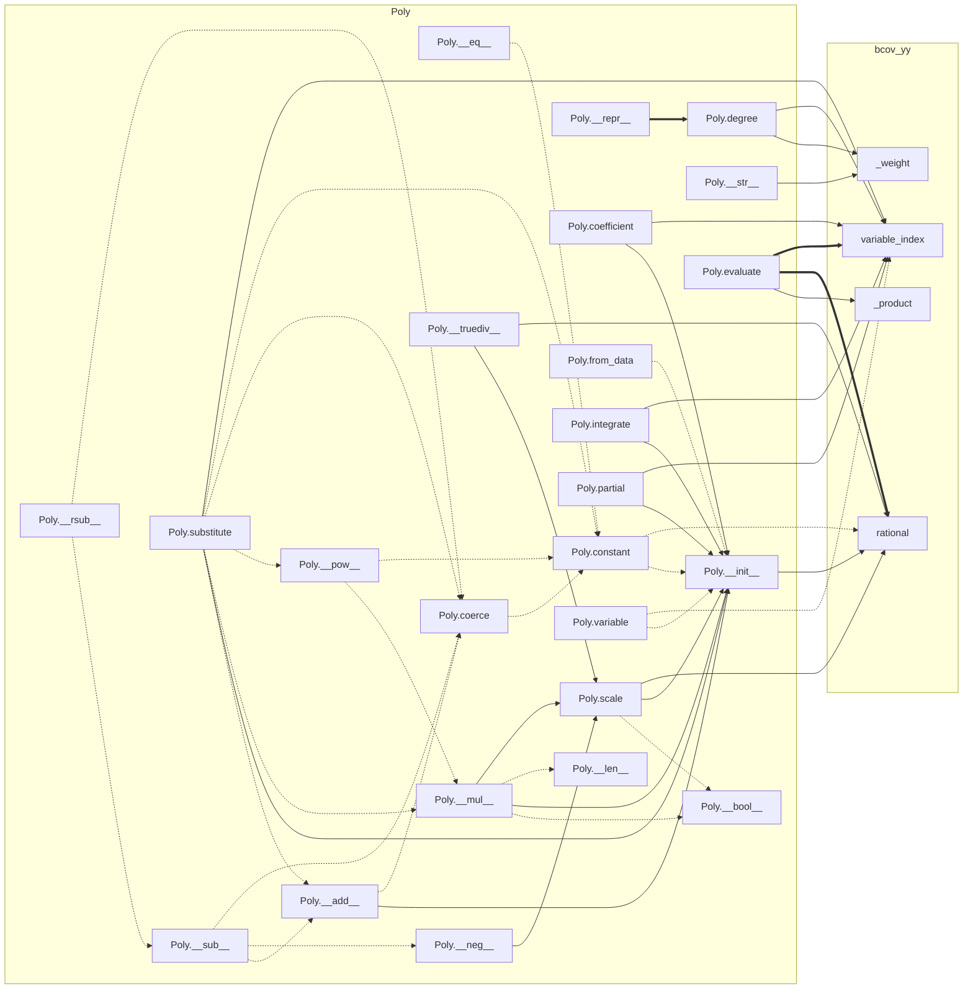
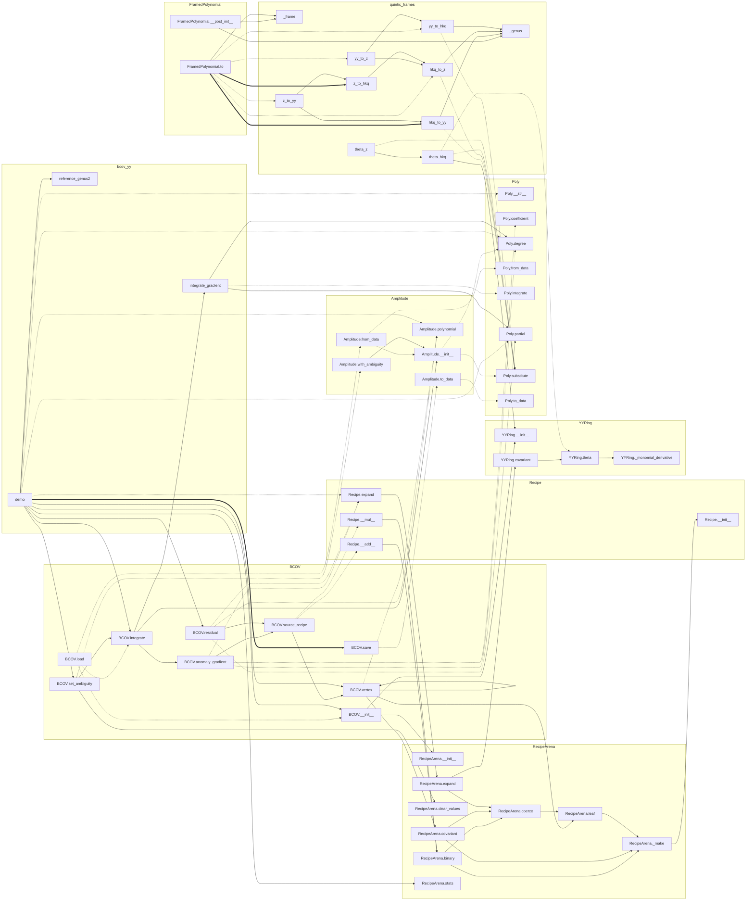

# bcovSymbolic toolkit

Exact-arithmetic quintic BCOV recursion, extracted from the `pypackage` branch.
The core modules are pruned, fully type-annotated and documented; the public names
the tutorial imports are unchanged. Standard library only, Python 3.10+, except
`test_gu_gauge.py` and `verify_yy_qseries_legacy.py`, which need SymPy.

## Layout

```
Quintic_BCOV_Tutorial.py   marimo tutorial (run from this directory)
run_all_checks.py          full regression suite, runs the checks inside bcov/
bcov/                      modules, scripts, tests and data
```

| `bcov/` file | Contents |
|---|---|
| `bcov_yy.py` | Sparse rational ring `Poly` in `u, v1, v2, v3, X`; `YYRing` (Euler derivation `theta`, covariant derivative); lazy `Recipe`/`RecipeArena` DAG; `Amplitude`; `integrate_gradient`; `BCOV` recursion solver with exact JSON checkpoints; `reference_genus2`, `YY_GENUS2_AMBIGUITY`; `demo` CLI |
| `quintic_frames.py` | Frame maps `yy_to_hkq`, `hkq_to_yy`, `hkq_to_z`, `z_to_hkq`, `yy_to_z`, `z_to_yy`; Euler derivations `theta_hkq`, `theta_z`; `GU_GAUGE`; frame-tagged `FramedPolynomial` |
| `CONVENTIONS.json` | Conventions ledger (frames, generators, normalization, gauge) |
| `test_frames.py` | Frame-change regression test against `CONVENTIONS.json` |
| `test_gu_gauge.py` | Gu/Klemm propagator differential identities (SymPy) |
| `bcov_sparse_converter.py` | Parses raw `ff_g` free energies into sparse z-frame atomic terms |
| `bcov_reconcile_frames.py` | Converts the z-frame atomic file to the HKQ frame |
| `quintic_invariant_extract.py` | Extracts `GVTab` and related integer tables from `quinticGVDTPT.m` without evaluating it |
| `audit_coefficients.py` | Bernoulli constant and linear pure-`X` coefficients, genera 2–15 → `low_x_reaudit_genus_2_15.csv` |
| `audit_denominators.py` | Denominator-lattice invariance of the pure-`X` polynomials → `denominator_invariants.csv` |
| `verify_physical_qseries.py` | Physical A-model `q`-series vs `GVTab` multicover prediction → `qseries_gv_residuals.json` |
| `verify_yy_qseries_legacy.py` | Older SymPy-based `q`-series check from the raw `ff_g` files (genus 2–3 GV assertions) |
| `tools/callgraph.py` | Builds the call graph below |
| `data/` | Raw free energies `ff_2..ff_15.txt`, `quinticGVDTPT.m`, extracted `GVTab.csv.gz`, HKQ atomic data `bcov_hkq_atomic_genus_2_15.jsonl.gz`, propagators, GV manifest and conflicts |

The pipeline, audit and verification scripts still use their own polynomial and
series code rather than `Poly`; that is unchanged for now.

## Running

From the repository root:

```bash
marimo edit Quintic_BCOV_Tutorial.py   # or: python Quintic_BCOV_Tutorial.py
python run_all_checks.py               # test_frames, test_gu_gauge, demo, audits, q-series
```

Individual scripts run from inside `bcov/`:

```bash
cd bcov
python bcov_yy.py --genus 3
python verify_yy_qseries_legacy.py
```

Rebuild the derived data from the raw inputs (the output matches `data/` exactly):

```bash
cd bcov
python bcov_sparse_converter.py --input-dir data --output /tmp/source_z.jsonl.gz --manifest /tmp/source_manifest.json
python bcov_reconcile_frames.py /tmp/source_z.jsonl.gz --output /tmp/source_hkq.jsonl.gz
python quintic_invariant_extract.py data/quinticGVDTPT.m --out /tmp/gv_tables
python verify_physical_qseries.py --atomic /tmp/source_hkq.jsonl.gz --gv /tmp/gv_tables/GVTab.csv.gz --genus 15 --degree 6
```

Result files the scripts write (`bcov/*.csv`, `bcov/qseries_gv_residuals.json`,
`bcov/notebook_output/`) are ignored by git.

## Call graph

Built from two sources. **pyan3** (static) guesses edges by name, so it both invents
calls and misses calls on objects other than `self`. A **runtime trace** of
`test_frames.py`, `bcov_yy.py --genus 4` and the tutorial records the calls that
actually happen. The diagrams show:

- `-->` found by pyan3 **and** observed at runtime
- `-.->` observed at runtime only (pyan3 missed it)
- `==>` real call (checked by reading the code) that the traced runs do not exercise

The solver diagram hides edges into `Poly` arithmetic and construction
(`+ - * / **`, `==`, `coerce`, `constant`, `scale`, `terms`, ...) and into the
helpers `rational`, `variable_index`, `_weight`, `_product`, since nearly every
function uses them; those edges appear in the first diagram.

### `Poly` and helpers



### Solver and frames



pyan3 edges rejected as false positives:

- `BCOV.save` → `BCOV.__init__`
- `Recipe.__add__` → `Recipe.__init__`
- `Recipe.__mul__` → `Recipe.__init__`
- `Recipe.expand` → `Recipe.__init__`
- `RecipeArena._make` → `RecipeArena.__init__`
- `RecipeArena.clear_values` → `RecipeArena.__init__`
- `YYRing.__init__` → `YYRing._monomial_derivative`
- `demo` → `integrate_gradient`

To regenerate:

```bash
cd bcov
pyan3 bcov_yy.py quintic_frames.py --uses --no-defines --dot > /tmp/cg.dot
python tools/callgraph.py /tmp/cg.dot /tmp/callgraph.md \
    test_frames.py "bcov_yy.py --genus 4" ../Quintic_BCOV_Tutorial.py
```

## Changes from `pypackage`

Removed (unused by the tutorial, tests, demo, or any other script on `pypackage`):

- `Poly.homogeneous_part`
- `YYRing.theta_z`: unused, and easily confused with the unrelated `quintic_frames.theta_z`
- `YYRing.clear_cache` and `BCOV.compact_recipes`
- `Recipe.__neg__`

Refactored without changing behaviour:

- Every function and method has type hints and a docstring; type aliases `Scalar`, `Variable`, `RecipeSpec`.
- `bcov_yy._weight` replaces three copies of the weighted-degree sum.
- `quintic_frames`: the generator substitutions are named constants
  (`_HKQ_IN_YY`, `_YY_IN_HKQ`, `_HKQ_Z_SWAP`); the frame-label check is `_frame`;
  the conversion table `_CONVERSIONS` is built once at import; `FRAMES` is derived from `Frame`.

Kept as is: all input-validation guards, and every name the tutorial imports.

All other scripts and `data/` are copied unchanged, except:

- `verify_yy_qseries_legacy.py` reads `data/ff_{g}.txt` next to the script
  instead of the hard-coded `/mnt/data/ff_{g}.txt`.
- `run_all_checks.py` runs its checks inside `bcov/`.
- The tutorial looks for the modules in `bcov/`, runs `run_all_checks.py` from the
  repository root, and its "how to run" text describes this layout.

Verified against `pypackage`: the `bcov_yy.py --genus 4` checkpoint is
byte-identical; `run_all_checks.py` passes; the tutorial runs (also with
`RUN_FULL_SUITE=True`) with output identical apart from the printed package path;
the audit and q-series result files are byte-identical; and rebuilding the HKQ
atomic data, `GVTab` and the disagreements table from the raw inputs reproduces
the files in `data/` exactly.
